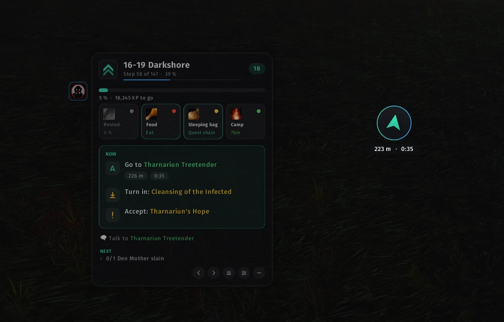
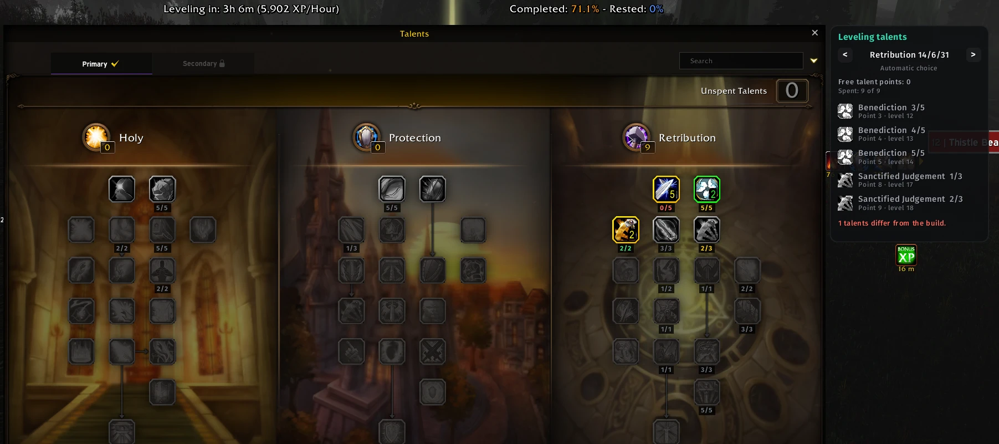
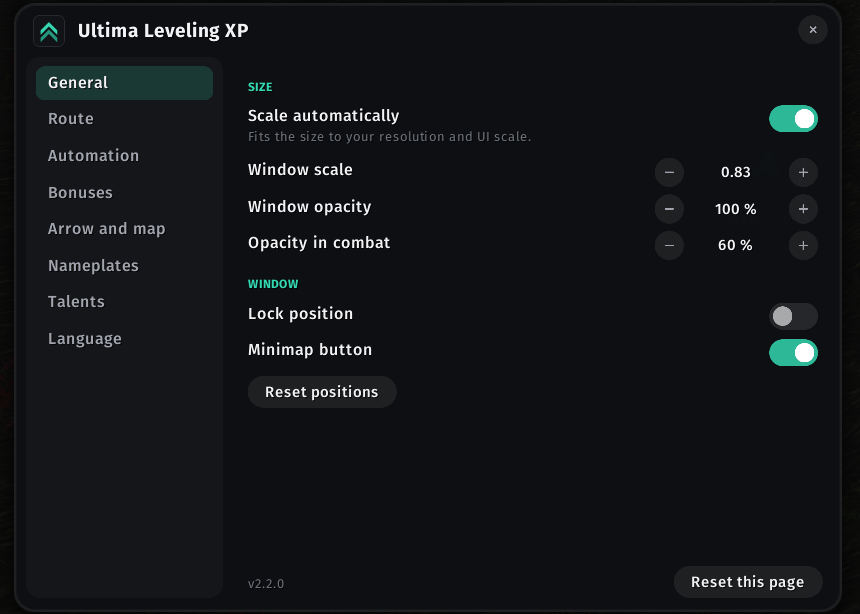

# Ultima Leveling XP

**The leveling companion for WoW Forever.** Ultima walks you from level 1 to 60 step by step, for
Alliance and Horde: it tells you where to go, which quests to accept and turn in, what to kill or
collect, and how to get there fastest. It keeps an eye on your bonuses, warns you about danger,
and shows you which talent to take next, right inside your talent window.

Free, open source (MIT), no ads, no account, no tracking. Available in 10 languages.

&nbsp;

[Features](#what-ultima-does) · [Talents](#leveling-talents) · [Installation](#installation) · [Commands](#commands) · [FAQ](#faq) · [Report a bug](https://github.com/Blackwellcode/ultima-leveling-xp/issues/new/choose) · [Deutsch](#deutsch)

> **Download:** use the button above or grab `UltimaLevelingXP.zip` from the
> [Releases](https://github.com/Blackwellcode/ultima-leveling-xp/releases) page.
> Do not use the green "Code" button or the "Source code" archives; they do not contain the route data.

---

## Contents

- [What Ultima does](#what-ultima-does)
- [The route window](#the-route-window)
- [Arrow and travel planner](#arrow-and-travel-planner)
- [Bonuses and warnings](#bonuses-and-warnings)
- [Automation](#automation)
- [Leveling talents](#leveling-talents)
- [Options](#options)
- [Languages](#languages)
- [Installation](#installation)
- [Commands](#commands)
- [Compatibility](#compatibility)
- [FAQ](#faq)
- [Support](#support)
- [Licenses](#licenses)
- [Deutsch](#deutsch)

---

## What Ultima does

Leveling in WoW Forever means a lot of tabbing between maps, quest logs and websites. Ultima puts
everything you need into one compact window and keeps it up to date while you play:

- **Routes from 1 to 60** for every race start of Alliance and Horde, continuing zone by zone up to
  Winterspring and Silithus at 60. Next to the regular routes there are dungeon routes, survival
  routes for a more careful pace and AoE routes for mages.
- **It follows you.** Ultima picks the route that fits your level, recognizes what you have already
  done (accepted, completed and turned-in quests, learned spells, items in your bags, professions)
  and moves on by itself. Steps you finished earlier are skipped, steps that cannot be done yet are
  postponed instead of blocking the route.
- **It looks ahead.** If you skipped an earlier route, Ultima offers to finish it first. Steps that
  only make sense for your race, class or faction are filtered automatically.

## The route window

- **Header:** route name, step counter, progress of the route and your level.
- **XP bar:** progress to the next level and the XP still missing.
- **Bonus tiles:** Rested, Well Fed, sleeping bag and camp at a glance (see below).
- **NOW:** the current step with all its actions: go to an NPC or place (with distance and time to
  arrival), accept, turn in, kill, collect, use an item, train, fly, set your Hearthstone.
- **Hints:** short hints for the step, for example who to talk to or which object to click; floors
  are announced ("upstairs", "downstairs").
- **NEXT:** a preview of what comes after the current step.
- **Buttons:** step back and forward, choose a route, open the options, collapse the window.
- **Quest item and target buttons:** if a step asks you to use an item, a button appears next to the
  window; another button targets the NPC or enemy of the step.

## Arrow and travel planner

- **Arrow:** points to the next goal and shows distance and time to arrival. It switches to a check
  mark when you arrive, shows when the goal is on another floor and guides you back to your corpse
  after a death.
- **Map markers:** the goal on the world map and minimap, with a dotted path on the minimap.
- **Travel planner:** for longer trips Ultima compares walking with flights and your Hearthstone and
  suggests the fastest way. Only flight paths your character already knows are used, and a suggestion
  only appears when it saves a noticeable amount of time (adjustable).

## Bonuses and warnings

- **Rested:** how much rested experience you have.
- **Well Fed:** shows whether the buff is active and offers buff food from your bags with one click.
  Food is recognized in every client language.
- **Sleeping bag and camp:** status of the WoW Forever sleeping bag (including the quest chain to get
  it) and the camp bonus with its remaining time.
- **Announcements:** when a bonus runs out, Ultima tells you in the middle of the screen.
- **Danger warnings:** enemies that are much higher than you and group members whose level lowers
  your kill XP are pointed out.
- **Nameplates:** quest markers and a level border on enemy nameplates show at a glance which enemies
  you need and which are dangerous.

## Automation

All of it is optional and can be switched off on its own. Hold **Shift** to pause every automation
for one interaction.

- **Quests:** accepts and turns in the quests of the current route. Other quests stay untouched, and
  if a quest offers a choice of rewards, Ultima never picks for you.
- **Trainer:** buys exactly the spells the step asks for.
- **Flight master:** selects the destination of the step.
- **Professions:** steps like "farm until Cooking 10" are skipped when your skill is already higher.

## Leveling talents

Open your talent window and Ultima shows the leveling build for your class:

- **Under every talent** of the build the target rank for your current points:
  green = done, yellow = still open, red = more points than the build plans or a talent the build
  does not use.
- **The next point glows** as soon as you have a free talent point.
- **A card next to the window** shows the build, your free and spent points, the next five talents
  with the level you get them at, and notes such as "talents differ from the build" or "respec
  recommended" for builds that change at a certain level.
- **Build choice:** Ultima picks the build that matches the points you already spent; with the arrows
  on the card you can choose any build of your class (several classes have more than one, for example
  solo and dungeon builds).
- **Talented:** the WoW Forever legacy perk that grants talent points earlier is taken into account.
- **Reminder:** a chat line tells you when a new talent point is free.

Ultima only draws its own marks over the talent window; it never changes Blizzard's frames and never
spends talent points for you.

## Options

Open with `/ultima options`, a right-click on the minimap button or the options button in the window.
Eight pages: General, Route, Automation, Bonuses, Arrow and map, Nameplates, Talents, Language.
Every change applies immediately, every page can be reset. The window scales automatically with your
screen resolution and UI scale (can be turned off).

## Languages

English, German, French, Spanish, Italian, Portuguese (Brazil), Russian, Korean, Simplified Chinese
and Traditional Chinese. The interface follows your game client unless you choose a language
(`/ultima language`). Route texts and NPC names come in the language of your client.

## Installation

1. Download [`UltimaLevelingXP.zip`](https://github.com/Blackwellcode/ultima-leveling-xp/releases/latest/download/UltimaLevelingXP.zip)
   (latest version) or pick a version on [Releases](https://github.com/Blackwellcode/ultima-leveling-xp/releases).
2. Extract it into `World of Warcraft\_forever_\Interface\AddOns`.
3. Keep all folders:

| Folder | Content |
|---|---|
| `UltimaLevelingXP` | the addon |
| `UltimaLevelingXP_A` / `UltimaLevelingXP_H` | routes for Alliance / Horde |
| `UltimaLevelingXP_<language>` | route texts and NPC names for your client language |

The route and language folders are loaded on demand: your character only loads its own faction and
language.

To update, delete the old `UltimaLevelingXP*` folders and extract the new archive. Your settings are
kept (they live in the `WTF` folder).

## Commands

`/ultima` or `/ulx` shows or hides the window.

| Command | Effect |
|---|---|
| `/ultima options` | open the options |
| `/ultima arrow` | show or hide the arrow |
| `/ultima routes` | choose a route |
| `/ultima auto` | pick the best route for your level and explain the choice |
| `/ultima quests` | quest automation on/off |
| `/ultima talents` | your leveling build and the next talent point in chat |
| `/ultima border` | level border on nameplates on/off |
| `/ultima hints` | hints on/off |
| `/ultima language [code]` | interface language, e.g. `en`, `de`, `auto` |
| `/ultima reset` | reset window positions |
| `/ultima status` | route state and diagnostics |
| `/ultima debug` | technical details for bug reports |

## Compatibility

- Made for the **WoW Forever** client (Interface 16001).
- Works on its own. Optional: Questie (quest markers on nameplates), EllesmereUI (fonts, nameplate
  border).
- Nothing protected is touched in combat; buttons and window changes wait until combat ends.

## FAQ

**The window shows no route.** Open `/ultima routes` and pick one, or run `/ultima auto`.

**Ultima sends me somewhere I already finished.** Click the step to skip it, or use the arrow buttons.
Please report it with the [wrong route step](https://github.com/Blackwellcode/ultima-leveling-xp/issues/new/choose)
form (route name and step number) so it can be fixed.

**Is there a talent build for every spec?** For almost all. Holy Priest has no leveling build yet.

**Lua error?** Please use the [bug report](https://github.com/Blackwellcode/ultima-leveling-xp/issues/new/choose)
form with the error text and the output of `/ultima debug`.

## Support

Ultima Leveling XP is free and stays free, with every feature for everyone. If it saves you time
while leveling, a coffee keeps the updates coming:

Just as helpful: a ⭐ on GitHub helps other players find the addon, and every reported wrong step
makes the routes better for everyone.

## Licenses

- Code, interface and graphics: MIT License, see [LICENSE](LICENSE).
- Route data: CC BY-NC-SA 4.0 (non-commercial, share alike), see `assets/CREDITS.txt` and
  `assets/LICENSE-DATA.txt`.
- Libraries in `libs/` (LibStub, CallbackHandler, HereBeDragons, LibDataBroker, LibDBIcon) keep their
  own licenses, see `assets/CREDITS.txt`.

For developers: `src/` holds the addon code (Lua 5.1), `tools/test-*.lua` the offline tests
(`lua tools/test-talents.lua` and others). The route database is generated separately and ships only
in the release archive.

---

## Deutsch

**Der Leveling-Begleiter für WoW Forever.** Ultima führt dich Schritt für Schritt von Stufe 1 bis 60,
für Allianz und Horde: wohin du gehst, welche Quests du annimmst und abgibst, was du töten oder
sammeln musst und wie du am schnellsten hinkommst. Dazu behält Ultima deine Boni im Blick, warnt vor
Gefahren und zeigt im Talentfenster, welches Talent als Nächstes dran ist.

Kostenlos, quelloffen (MIT), ohne Werbung, ohne Konto, ohne Datensammlung. In 10 Sprachen.

**Das kann Ultima**

- **Routen von 1 bis 60** für alle Startgebiete, dazu Dungeon-, Survival- und Magier-AoE-Routen.
  Ultima wählt die passende Route, erkennt Erledigtes (Quests, Zauber, Gegenstände, Berufe) und geht
  von selbst weiter. Was noch nicht geht, wird zurückgestellt statt die Route zu blockieren.
- **Fenster:** Route, Fortschritt, XP-Balken, Bonus-Kacheln, aktueller Schritt mit allen Handlungen,
  Hinweise (auch "oben"/"unten" bei Stockwerken), Vorschau auf den nächsten Schritt, Knöpfe für
  Quest-Gegenstand und Ziel.
- **Pfeil** mit Entfernung und Ankunftszeit, Markierungen auf Welt- und Minikarte, Leichenlauf.
- **Reiseplaner:** vergleicht Laufen mit Flug und Ruhestein, nutzt nur bekannte Flugpunkte.
- **Boni:** Erholt, Satt (Essen aus der Tasche per Klick, in jeder Client-Sprache erkannt),
  Schlafsack und Lager; Meldung, wenn ein Bonus ausläuft.
- **Warnungen** vor zu starken Gegnern und hohen Gruppenmitgliedern, Markierungen auf Namensplaketten.
- **Automatik** (alles einzeln abschaltbar, Umschalt hält sie an): Quests der Route annehmen und
  abgeben (wählt nie eine Belohnung für dich), beim Lehrer die verlangten Zauber kaufen, beim
  Flugmeister das Ziel wählen. Schritte wie "Kochen auf 10" entfallen, wenn dein Beruf schon höher ist.
- **Leveling-Talente** im Talentfenster: Zielrang unter jedem Talent (grün/gelb/rot), Leuchten auf dem
  nächsten Punkt, Karte mit Build-Wahl und den nächsten fünf Talenten, Hinweis bei Neuverteilung,
  Erinnerung im Chat. Ultima verteilt nie selbst Punkte.
- **Optionen** auf acht Seiten, automatische Skalierung nach Auflösung.
- **Sprachen:** Oberfläche folgt dem Client, Routen-Texte und NPC-Namen in der Client-Sprache.

**Installation:** [`UltimaLevelingXP.zip`](https://github.com/Blackwellcode/ultima-leveling-xp/releases/latest/download/UltimaLevelingXP.zip)
herunterladen (neueste Version; nicht das "Source code"-Archiv), nach `World of Warcraft\_forever_\Interface\AddOns` entpacken, alle Ordner
behalten. Bedienung über `/ultima`, Optionen über `/ultima optionen` oder Rechtsklick auf das
Minimap-Symbol. Fehler und falsche Routen-Schritte bitte über die
[Formulare](https://github.com/Blackwellcode/ultima-leveling-xp/issues/new/choose) melden, mit Fehlertext
und der Ausgabe von `/ultima debug`.

**Unterstützen:** Ultima ist und bleibt kostenlos, alle Funktionen für alle. Wenn es dir beim Leveln Zeit
spart, freue ich mich über einen Kaffee: [buymeacoffee.com/blackwellcode](https://buymeacoffee.com/blackwellcode).
Ein ⭐ auf GitHub hilft anderen Spielern, das Addon zu finden.
